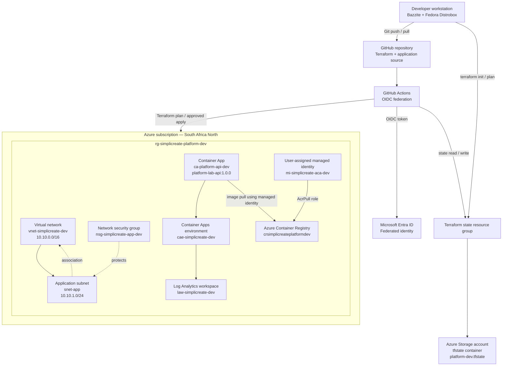

# Architecture

## Logical topology

## Components and responsibilities

| Layer | Component | Purpose |
|---|---|---|
| Source control | GitHub repository | Stores Terraform configuration, application source, tests, and workflow definitions. |
| CI/CD | GitHub Actions | Runs validation and the manually gated deployment workflow. |
| Workload identity | Microsoft Entra ID federated credential | Lets GitHub Actions exchange its OIDC token for Azure access without a stored client secret. |
| State | Azure Storage backend | Stores `platform-dev.tfstate` and provides Terraform state locking. |
| Network | Virtual network, subnet, NSG | Defines the lab network boundary and subnet security controls. |
| Image registry | Azure Container Registry | Stores the application container image. |
| Compute | Azure Container Apps environment and app | Hosts the Python API container. |
| Identity | User-assigned managed identity | Gives the Container App `AcrPull` access without embedding registry credentials. |
| Observability | Log Analytics workspace | Receives Container Apps environment logs. |

## Security boundaries

- The GitHub Actions service principal uses OIDC federation, not a long-lived client secret.
- Infrastructure permissions are scoped to the development resource group; blob data permissions are scoped to the Terraform state storage account.
- The Container App's managed identity is separate from the GitHub Actions deployment identity.
- Terraform state can contain sensitive values. Restrict access to the storage account and never commit state files.
- The current deployment workflow can apply infrastructure changes when manually dispatched on `main` with `confirm_deploy=true`. A successful workflow run is not the same as a validation-only run.

## Important accuracy note

This diagram describes the known resource inventory and identity relationships for this lab. Verify any network integration, ingress, egress, and subnet associations against `main.tf` and the Azure portal before using the diagram as a production design.
